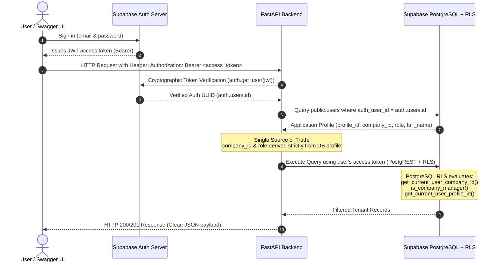

# Multi-Tenant Task Management API (Supabase & FastAPI)

A secure, production-grade, backend-only multi-tenant task management system designed for multi-company isolation and Role-Based Access Control (RBAC). Integrated with **Supabase Authentication**, **FastAPI**, **Supabase PostgreSQL**, and **PostgreSQL Row Level Security (RLS)**.

---

## 📋 Table of Contents

- [Architecture & Authentication Flow](#-architecture--authentication-flow)
- [Directory Structure](#-directory-structure)
- [Technology Stack](#-technology-stack)
- [Multi-Tenant Data Model & Security Boundaries](#-multi-tenant-data-model--security-boundaries)
- [Setup & Configuration Guide](#-setup--configuration-guide)
  - [1. Environment Configuration](#1-environment-configuration)
  - [2. Supabase Migration & Database Setup](#2-supabase-migration--database-setup)
  - [3. Supabase Auth User Setup & Profile Mapping](#3-supabase-auth-user-setup--profile-mapping)
- [Running the Backend (Windows PowerShell)](#-running-the-backend-windows-powershell)
- [Obtaining Access Tokens (CLI Helper)](#-obtaining-access-tokens-cli-helper)
- [Testing via Swagger UI (Bearer Authentication)](#-testing-via-swagger-ui-bearer-authentication)
- [Automated Testing](#-automated-testing)
  - [TypeScript Tests (Task A)](#typescript-tests-task-a)
  - [FastAPI Mocked Tests (Task B)](#fastapi-mocked-tests-task-b)
  - [Real Supabase Integration Tests (Opt-In)](#real-supabase-integration-tests-opt-in)
- [Demonstrating Multi-Tenant Isolation](#-demonstrating-multi-tenant-isolation)
- [Known Limitations & Design Disclosures](#-known-limitations--design-disclosures)

---

## 🏛️ Architecture & Authentication Flow

This is a **strictly backend-only** application. OpenAPI / Swagger UI (`/docs`) serves as the interactive client.



---

## 📁 Directory Structure

```
multi-tenant-task-manager/
├── .env.example                       # Environment template with placeholders
├── .gitignore                         # Protects .env, build artifacts, and caches
├── pytest.ini                         # Pytest configuration and warning filters
├── package.json                       # TypeScript test & build scripts
├── tsconfig.json                      # Strict TypeScript compiler options
├── README.md                          # Production architecture & operations documentation
├── task-a-typescript/                 # Task A: TypeScript Library
│   ├── src/
│   │   ├── types.ts                   # Interfaces, Enums, Custom Errors, FetchTasksOptions
│   │   ├── taskService.ts             # filterByStatus, calculateCompletionPercentage, fetchTasks
│   │   └── index.ts                   # Public exports
│   └── tests/
│       └── taskService.test.ts        # Automated unit tests (22 tests passing)
├── task-b-fastapi/                    # Task B: Python / FastAPI REST API
│   ├── requirements.txt               # Pinned dependencies (fastapi, supabase, pydantic, etc.)
│   ├── app/
│   │   ├── main.py                    # App entrypoint, CORS, exception handlers
│   │   ├── config.py                  # Settings (Supabase URL, publishable key, env)
│   │   ├── core/
│   │   │   ├── auth.py                # Supabase Auth verification, profile derivation, HTTPBearer
│   │   │   ├── supabase_client.py     # Request-scoped concurrency-safe client factory
│   │   │   └── exceptions.py          # Domain-level exception hierarchy
│   │   ├── schemas/
│   │   │   ├── task.py                # Pydantic v2 validation models (TaskCreate, TaskResponse)
│   │   │   └── user.py                # User and Company schemas
│   │   ├── models/
│   │   │   └── domain.py              # Domain dataclasses
│   │   ├── repositories/
│   │   │   ├── task_repository.py     # Repository protocol and provider
│   │   │   ├── supabase_task_repository.py  # Production Supabase PostgREST repository
│   │   │   └── in_memory_task_repository.py # Test double for isolated unit tests
│   │   ├── services/
│   │   │   └── task_service.py        # RBAC, tenant isolation, and task state machine
│   │   └── api/
│   │       ├── deps.py                # Dependency injection for current user & task service
│   │       └── v1/
│   │           └── tasks.py           # REST route handlers (POST, GET, PATCH)
│   ├── scripts/
│   │   └── get_access_token.py        # Secure CLI helper to obtain JWT access tokens
│   └── tests/
│       ├── conftest.py                # Pytest fixtures and mock users
│       ├── test_tasks_api.py          # Mocked authorization & API unit tests (22 tests)
│       └── test_supabase_live.py      # Opt-in live Supabase integration tests
└── task-c-database/                   # Task C: PostgreSQL / Supabase Database & Security
    ├── migrations/
    │   └── 002_supabase_auth_integration.sql # Safe additive migration for hosted Supabase
    ├── scripts/
    │   └── map_auth_users.sql         # SQL mapping template for the 5 demo users
    ├── schema.sql                     # Base tables, constraints, composite FKs, triggers, indexes
    ├── rls.sql                        # Base Row Level Security policies
    ├── queries.sql                    # Parameterized operational & analytical queries
    ├── seed.sql                       # Seed data for Acme Innovations & Beta Robotics
    └── security_architecture.md       # In-depth security analysis on parameter tampering defense
```

---

## 🛠️ Technology Stack

- **Runtime**: Python 3.10+ (tested on Python 3.14) & Node.js 20+ (tested on Node.js 24)
- **Web Framework**: FastAPI 0.115+
- **Database & Auth**: Supabase (PostgreSQL 15+, GoTrue Auth, PostgREST)
- **Data Validation**: Pydantic v2.14+
- **TypeScript**: TypeScript 5.7+ with strict typing and `NodeNext` resolution
- **Testing**: Pytest 9+ (Python) and Node.js Test Runner / `tsx` (TypeScript)

---

## 🛡️ Multi-Tenant Data Model & Security Boundaries

### Two Distinct Identifiers: Auth UID vs. Profile UUID
A critical security distinction in this architecture:
1. **Supabase Auth UID** (`auth.users.id` / `auth.uid()`): The cryptographic user identity generated when an employee or manager logs in.
2. **Application Profile ID** (`public.users.id`): The internal UUID used within the application schema, referenced by `tasks.created_by` and `tasks.assigned_to`.

The bridge is `public.users.auth_user_id`:
```
auth.users (auth.uid())  ───[1:1 via auth_user_id]───>  public.users.id (Profile ID)
```

### Zero-Trust Tenancy Principles
- **No Client Trust**: The API **never** accepts `company_id` from client payloads or headers.
- **Single Source of Truth**: The user's `company_id` and `role` are read directly from `public.users` after cryptographically validating the JWT with `supabase.auth.get_user(jwt)`.
- **Database Row Level Security (RLS)**: Requests forward the user's access token to PostgREST. PostgreSQL enforces `get_current_user_company_id()`, `is_company_manager()`, and `get_current_user_profile_id()`.
- **Composite Foreign Key**: `(company_id, assigned_to) REFERENCES users(company_id, id)` ensures cross-company task assignment is physically impossible at the database engine level.

---

## 🚀 Setup & Configuration Guide

### 1. Environment Configuration

Copy the template file to `.env`:
```powershell
Copy-Item .env.example .env
```

Open `.env` and configure your Supabase credentials (found in Supabase Dashboard -> **Project Settings** -> **API**):
```ini
SUPABASE_URL=https://your-project-id.supabase.co
SUPABASE_PUBLISHABLE_KEY=your-publishable-or-anon-key-here
APP_ENV=development
```
> [!IMPORTANT]
> Never use or commit a `service_role` or secret key. All ordinary queries run using the user's verified JWT and the publishable/anon key.

---

### 2. Supabase Migration & Database Setup

Since the initial `schema.sql`, `seed.sql`, and `rls.sql` have already been executed on your hosted Supabase project, apply the **safe, additive migration**:

1. Open the **Supabase Dashboard** -> **SQL Editor**.
2. Open [`task-c-database/migrations/002_supabase_auth_integration.sql`](file:///d:/multi-tenant-task-manager/task-c-database/migrations/002_supabase_auth_integration.sql).
3. Copy its contents and click **Run**.

**What this migration does:**
- Safely adds `auth_user_id UUID UNIQUE REFERENCES auth.users(id)` to `public.users`.
- Replaces security helper functions with `SECURITY DEFINER SET search_path = ''` resolving identities via `auth.uid() -> public.users.auth_user_id -> public.users.id`.
- Upgrades RLS policies for `companies`, `users`, and `tasks`.
- Preserves all existing seed data.

---

### 3. Supabase Auth User Setup & Profile Mapping

The seeded database contains 5 demo profiles:

| Company | Role | Full Name | Email Address | Profile UUID |
|---|---|---|---|---|
| **Company Alpha** (Acme) | Manager | Alice Manager | `alice.manager@acme.com` | `a1111111-1111-1111-1111-111111111111` |
| **Company Alpha** (Acme) | Employee | Bob Developer | `bob.developer@acme.com` | `a2222222-2222-2222-2222-222222222222` |
| **Company Alpha** (Acme) | Employee | Carol Designer | `carol.designer@acme.com` | `a3333333-3333-3333-3333-333333333333` |
| **Company Beta** (Beta Robotics) | Manager | David Manager | `david.manager@betarobotics.com` | `b1111111-1111-1111-1111-111111111111` |
| **Company Beta** (Beta Robotics) | Employee | Eve Engineer | `eve.engineer@betarobotics.com` | `b2222222-2222-2222-2222-222222222222` |

#### Steps to Create Auth Users in Supabase Dashboard:
1. Go to **Authentication** -> **Users** -> Click **Add User** -> **Create User**.
2. Create each of the 5 users with their exact email address above and a password of your choice (e.g. `TestPass123!`). Check **Auto Confirm Email**.
3. After creating the users, copy each user's **User UID** (UUID).
4. Open [`task-c-database/scripts/map_auth_users.sql`](file:///d:/multi-tenant-task-manager/task-c-database/scripts/map_auth_users.sql).
5. Paste the respective Auth UIDs into the placeholders:
   ```sql
   UPDATE public.users SET auth_user_id = '<AUTH_UUID_FOR_ALICE>'::UUID WHERE email = 'alice.manager@acme.com';
   UPDATE public.users SET auth_user_id = '<AUTH_UUID_FOR_BOB>'::UUID WHERE email = 'bob.developer@acme.com';
   UPDATE public.users SET auth_user_id = '<AUTH_UUID_FOR_CAROL>'::UUID WHERE email = 'carol.designer@acme.com';
   UPDATE public.users SET auth_user_id = '<AUTH_UUID_FOR_DAVID>'::UUID WHERE email = 'david.manager@betarobotics.com';
   UPDATE public.users SET auth_user_id = '<AUTH_UUID_FOR_EVE>'::UUID WHERE email = 'eve.engineer@betarobotics.com';
   ```
6. Run the script in the Supabase SQL Editor.

---

## 💻 Running the Backend (Windows PowerShell)

### Prerequisites & Python Virtual Environment
```powershell
# Activate Python virtual environment
.\.venv\Scripts\Activate.ps1

# Install / update requirements
pip install -r task-b-fastapi/requirements.txt
```

### Start the FastAPI Server
```powershell
uvicorn app.main:app --port 8000 --app-dir task-b-fastapi --reload
```
Output:
```
INFO:     Uvicorn running on http://127.0.0.1:8000 (Press CTRL+C to quit)
INFO:     Started reloader process
INFO:     Application startup complete.
```

---

## 🔑 Obtaining Access Tokens (CLI Helper)

Use the built-in command-line script to log in as any user and generate an access token for testing:

```powershell
.\.venv\Scripts\python.exe task-b-fastapi/scripts/get_access_token.py
```

Prompts:
```
Enter Supabase Auth Email: alice.manager@acme.com
Enter Supabase Auth Password: ********

======================================================================
AUTHENTICATION SUCCESSFUL!
======================================================================
User Email   : alice.manager@acme.com
Auth UID     : 8f42c123-4567-890a-bcde-f1234567890a
----------------------------------------------------------------------
BEARER ACCESS TOKEN (Copy and paste into Swagger UI 'Authorize' modal):
----------------------------------------------------------------------
eyJhbGciOiJIUzI1NiIsInR5cCI6IkpXVCJ9...
======================================================================
```

---

## 🌐 Testing via Swagger UI (Bearer Authentication)

1. Open your browser and navigate to: **[http://localhost:8000/docs](http://localhost:8000/docs)**
2. Click the green **Authorize 🔒** button at the top right.
3. In the **Value** field, paste the JWT access token obtained from `get_access_token.py` (do not type "Bearer", Swagger adds it automatically).
4. Click **Authorize**, then **Close**.

Now, every request executed in Swagger UI automatically sends:
```http
Authorization: Bearer <access_token>
```

---

## 🧪 Automated Testing

### TypeScript Tests (Task A)
Tests filtering, completion percentage calculations, envelope unwrapping, runtime schema validation, Authorization Bearer header inclusion, and snake_case to camelCase conversion.

```powershell
npm run test:ts
```
Expected output:
```
✔ Task A: TypeScript Task Management Module
  ✔ filterTasksByStatus() (4 tests passed)
  ✔ calculateCompletionPercentage() (7 tests passed)
  ✔ fetchTasks() (11 tests passed)
ℹ tests 22 | pass 22 | fail 0
```

### TypeScript Type Check & Build
```powershell
npx tsc --noEmit
npm run build:ts
```

### FastAPI Mocked Tests (Task B)
Exhaustive unit test suite covering health, missing token (401), invalid JWT (401), manager permissions, employee permissions, cross-company assignment prevention (400), tenant isolation, metrics calculation, employee-assigned filter lockdown, cross-tenant IDOR (404), state machine transitions, and database error mapping.

```powershell
pytest -v
```
Expected output:
```
task-b-fastapi/tests/test_tasks_api.py::test_health_endpoint PASSED
task-b-fastapi/tests/test_tasks_api.py::test_missing_bearer_token_rejected PASSED
task-b-fastapi/tests/test_tasks_api.py::test_invalid_bearer_token_rejected PASSED
task-b-fastapi/tests/test_tasks_api.py::test_valid_manager_authentication PASSED
task-b-fastapi/tests/test_tasks_api.py::test_valid_employee_authentication PASSED
task-b-fastapi/tests/test_tasks_api.py::test_manager_can_create_task PASSED
task-b-fastapi/tests/test_tasks_api.py::test_employee_cannot_create_task PASSED
task-b-fastapi/tests/test_tasks_api.py::test_manager_cannot_assign_task_to_different_company_employee PASSED
task-b-fastapi/tests/test_tasks_api.py::test_client_supplied_company_id_cannot_override_tenant PASSED
task-b-fastapi/tests/test_tasks_api.py::test_create_task_validation_error PASSED
task-b-fastapi/tests/test_tasks_api.py::test_manager_sees_all_own_company_tasks PASSED
task-b-fastapi/tests/test_tasks_api.py::test_employee_sees_only_assigned_tasks PASSED
task-b-fastapi/tests/test_tasks_api.py::test_employee_cannot_bypass_assigned_to_filter PASSED
task-b-fastapi/tests/test_tasks_api.py::test_get_tasks_metrics_calculation PASSED
task-b-fastapi/tests/test_tasks_api.py::test_get_tasks_filter_by_status PASSED
task-b-fastapi/tests/test_tasks_api.py::test_assigned_employee_can_update_task_status PASSED
task-b-fastapi/tests/test_tasks_api.py::test_employee_cannot_update_unassigned_task PASSED
task-b-fastapi/tests/test_tasks_api.py::test_manager_can_update_any_task_in_their_company PASSED
task-b-fastapi/tests/test_tasks_api.py::test_cross_tenant_patch_manipulation_returns_404 PASSED
task-b-fastapi/tests/test_tasks_api.py::test_employee_cannot_reopen_completed_task PASSED
task-b-fastapi/tests/test_tasks_api.py::test_invalid_status_enum_rejected PASSED
task-b-fastapi/tests/test_tasks_api.py::test_database_error_handling_returns_500_without_leaks PASSED
task-b-fastapi/tests/test_tasks_api.py::test_missing_supabase_config_returns_503 PASSED
task-b-fastapi/tests/test_tasks_api.py::test_task_immutable_fields_cannot_be_altered_via_patch PASSED
task-b-fastapi/tests/test_tasks_api.py::test_get_tasks_pagination_limit_and_offset PASSED
======================== 25 passed, 1 skipped in 0.20s ========================
```

### Real Supabase Integration Tests (Opt-In)
To run the live integration tests against your actual hosted Supabase project:

```powershell
$env:RUN_SUPABASE_INTEGRATION_TESTS="1"
$env:SUPABASE_MGR_ALPHA_TOKEN="<token_from_get_access_token_for_alice>"
$env:SUPABASE_EMP_ALPHA_TOKEN="<token_from_get_access_token_for_bob>"
$env:SUPABASE_MGR_BETA_TOKEN="<token_from_get_access_token_for_david>"

pytest task-b-fastapi/tests/test_supabase_live.py -v
```

---

## 🎯 Demonstrating Multi-Tenant Isolation

### Demonstration 1: Manager Creates a Task
1. Authenticate in Swagger as Alice (`alice.manager@acme.com`).
2. Execute `POST /tasks`:
   ```json
   {
     "title": "Q4 Infrastructure Security Review",
     "priority": "high",
     "assigned_to": "a2222222-2222-2222-2222-222222222222"
   }
   ```
3. Response: `201 Created`. `company_id` is automatically set to Company Alpha (`a0000000-0000-0000-0000-000000000001`), and `created_by` is Alice's profile ID (`a1111111-1111-1111-1111-111111111111`).

### Demonstration 2: Employee Sees Only Assigned Tasks
1. Authenticate in Swagger as Bob (`bob.developer@acme.com`).
2. Execute `GET /tasks`.
3. Notice that Bob receives **only tasks assigned to him**. Carol's tasks in the same company are hidden.
4. Try appending `?assigned_to=a3333333-3333-3333-3333-333333333333` (Carol's ID).
5. The API enforces employee-level assigned scoping and still returns only Bob's tasks.

### Demonstration 3: Employee Updates Task Status
1. Still authenticated as Bob, execute `PATCH /tasks/a1000000-0000-0000-0000-000000000002`:
   ```json
   { "status": "completed" }
   ```
2. Response: `200 OK`. Status updated to `completed`.
3. Try executing `PATCH /tasks/a1000000-0000-0000-0000-000000000003` (Carol's task).
4. Response: `404 Not Found` (matching RLS policy where unassigned tasks are hidden from employees to prevent resource enumeration).

### Demonstration 4: Database Column Privilege Verification
To confirm that PostgreSQL strictly prevents employees or managers from modifying protected columns (`role`, `auth_user_id`, `company_id`, `assigned_to`, `created_by`), run [`task-c-database/scripts/verify_permissions.sql`](file:///d:/multi-tenant-task-manager/task-c-database/scripts/verify_permissions.sql) in the Supabase SQL Editor.
The query confirms that `tasks.status` and `tasks.updated_at` evaluate to `ALLOWED`, while all other columns evaluate to `DENIED`.

### Demonstration 4: Cross-Tenant Isolation (Alpha vs. Beta)
1. Authenticate in Swagger as David (`david.manager@betarobotics.com`, Manager of Beta).
2. Execute `GET /tasks`.
3. Notice that David receives **only Beta Robotics tasks**. Zero Company Alpha tasks appear.
4. Execute `PATCH /tasks/a1000000-0000-0000-0000-000000000001` (Alpha task ID).
5. Response: **`404 Not Found`**. The API deliberately returns 404 instead of 403 to prevent cross-tenant resource enumeration.

---

## 🔍 Known Limitations & Design Disclosures

In a technical interview, transparently disclosing architectural trade-offs demonstrates senior engineering maturity:

1. **Token Refresh via Gateway**: The FastAPI backend validates access tokens using server-side Supabase verification. Token refresh (handling expired access tokens via refresh tokens) is expected to be managed by the client or API gateway.
2. **Synchronous Supabase Client**: The backend uses the official Supabase Python SDK (`supabase-py`). The PostgREST operations use synchronous HTTP calls wrapped in FastAPI thread pools (`def` routes). For high-throughput async workloads, an async client (`AsyncClient`) would be preferred.
3. **Database Profile Lookup Overhead**: On each authenticated request, the application verifies the token via Supabase Auth and queries `public.users` to obtain the profile. In high-traffic production environments, caching the `auth.uid() -> profile` mapping in Redis with a short TTL (e.g. 5 minutes) minimizes database lookups.
4. **Task Deletion**: The system deliberately denies `DELETE /tasks` at the RLS policy layer. Task archiving is handled via the `cancelled` status rather than permanent row deletion to preserve audit history.
